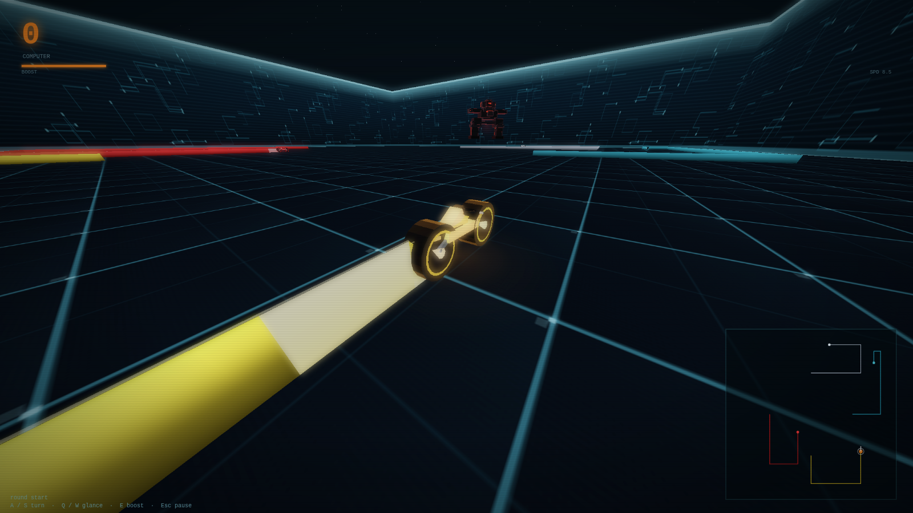

# WebGLTron — lightcycle arena

WebGLTron is a self-contained browser recreation of **gltron**, the classic 3D lightcycle game.
Everything — arena, trails, bikes, HUD, menus — is generated in code, with the
menu title set in an embedded Orbitron typeface. The crash and recognizer effects
are gltron's originals, embedded as small data URIs; the optional soundtracks are
`music/Amber_Corridor.mp3`, `music/Underground_Siege.mp3`,
`music/Revenge_of_the_Cats.mp3` and `music/Grid_Loop_1.mp3` next to the page. There
are no libraries or network requests.

**Play it:** open `index.html` in any modern browser (Chrome, Firefox, Safari, Edge).
No build step, no server required.  Keep the optional `music/` tracks
next to it if you want the soundtracks.



## Features

- **Faithful rules and physics** ported from the original gltron 0.70 sources:
  the 4-direction grid, turn segments, trail collision, the speed oscillator,
  booster drain/regeneration, wall acceleration, erasing dead players,
  and the score-on-crash convention.
- **The original computer opponents** — distance rays, "simple" spiral steering,
  and the aggressive/evasive attack tables used against human players, with all
  four bot skill levels.
- **The original camera modes** — circling, behind, cockpit and free/mouse,
  including the turn-coupled interpolation, glance offsets, and the recognizer
  observer camera after you derezz.
- **A Tron-style Recognizer** — the huge black mech with red trim and wireframe
  that patrols above the arena, rebuilt from the silhouette of the original
  model.
- **3D WebGL rendering** with a neon arena: textured grid floor, circuit-board
  walls, procedural lightcycles, glowing trail walls, shadows, explosions,
  the flying recognizer, and a bloom post-process.
- **Up to four players** in single, split-screen or quad viewports; human or
  computer controlled per player.
- **Attract mode** behind the menu, plus a full-screen demo you can watch.
- **Audio** — synthesised engine hum and booster whoosh, plus gltron's original
  derezz and recognizer-flyby effects. The music can be switched between the
  three-track **Mix** (Revenge of the Cats → Grid Loop 1 → Underground Siege),
  any individual track, the built-in synth, or off.
- **Idle cursor hiding** — the pointer disappears while you play once it stops
  moving, and comes back the moment you move it.
- **Menus, pause, help and round-over screens**, persisted settings and scores,
  minimap, FPS counter, touch controls and gamepad support.

## Controls

| Player | Turn left | Turn right | Glance left | Glance right | Boost |
|--------|-----------|------------|-------------|--------------|-------|
| 1 | `A` | `S` | `Q` | `W` | `E` |
| 2 | `J` | `K` | `U` | `I` | `L` |
| 3 | `←` | `→` | `Del` | `End` | `↓` |
| 4 | `4` | `6` | `7` | `9` | `5` |

When exactly one human is playing, **arrow keys + Space** also work for that player.
Numpad digits work as well as the number row for player 4.

| Global | |
|--------|---|
| `Esc` / `P` | pause / resume |
| `R` | restart the round |
| `M` | mute |
| `H` | controls |
| `F10` / `C` | cycle camera mode |
| `F1`–`F4` | viewports: single / split / quad / auto |

In the menu: `↑`/`↓` select, `←`/`→` change a value, `Enter` confirm.
In Mouse camera mode, drag to orbit and use the wheel to zoom.
A connected gamepad controls the first human player (stick/d-pad to turn,
A/RB/LB/RB to boost).

## Rules

Your cycle never stops and never slows down. The trail it leaves behind is solid:
touching **any** trail — including your own — or the arena wall derezzes you.
Outlast every opponent to win the round; if every cycle derezzes, the last one to
crash wins. Every remaining player scores a point
when a cycle derezzes, so the last survivor takes the most points.

The booster accelerates you while held and bleeds off when released; it regenerates
when not in use. Glancing turns your head (camera) without turning the bike.

## Settings

All settings are in the main menu and persist in `localStorage`:

- **Players 1–4** — human, computer, or none (at least two cycles must play)
- **Arena** — tiny (160) to extreme (1200)
- **Game speed** — boring (5) to crazy (12)
- **Game type** — classic, booster, wall acceleration, or both
- **Bot skill** — dumb, normal, strong, "the MCP himself"
- **Erase dead players**, **Fast finish**
- **Camera** — circling, behind, cockpit, mouse
- **Viewports** — auto, single, split, quad
- **2D map** — none to huge
- **Glow**, **Recognizer**, **Sound**
- **Music** — `off`, `mix` (default; Revenge of the Cats → Grid Loop 1 →
  Underground Siege), `amber`, `siege`, `original` (*Revenge of the Cats*),
  `grid` (*Grid Loop 1*), or `synth`
- **Reset scores** and **Controls**

## URL parameters (handy for demos and testing)

`?play=1` starts a round immediately, `?spectate=1` skips the menu,
`?seed=N` fixes the random seed, `?arena=N`, `?speed=N`, `?humans=N`,
`?cam=0..3`, `?vp=single|split|quad|auto`, `?time=MS` fast-forwards the round,
`?hud=0` hides the HUD, `?nosound=1` starts muted,
`?music=off|mix|amber|siege|original|grid|synth` picks a soundtrack, `?touch=1` forces the
touch pad, `?fps=1` shows the frame counter.

Examples:

```
index.html?play=1&humans=4&vp=quad
index.html?spectate=1&arena=480&time=15000
index.html?play=1&humans=1&cam=2&time=800        (cockpit, first second)
```

## Implementation notes

``index.html` is the whole game: HTML/CSS UI, the simulation core, a small WebGL
renderer and the app shell in one file. The simulation (physics, collisions, AI,
camera) is deterministic for a given seed and is independent of rendering; it is
stepped at the original 20 ms physics tick, with the frame delta split into
substeps. Rendering uses GLSL ES 1.0 with a scene render target, a bright-pass
and separable blur for bloom, and a tonemapped composite. Every texture and mesh
is generated procedurally at startup. Audio is built with the Web Audio API.

## Credits and license

This is a tribute to **gltron 0.70** by Andreas Umbach, Michael Kircher and
contributors (https://www.gltron.org/). The optional *"Revenge of Cats"*
soundtrack is by **Peter Hajba (Skaven)**, as shipped with gltron and
copyright Peter Hajba; it is included here with the original attribution.
The game also ships with the additional soundtrack tracks *"Amber Corridor"*,
*"Underground Siege"* and *"Grid Loop 1"*. The game rules, lightcycle physics,
computer-player logic, camera behaviour and several visual constants were ported
from the original GPL sources; the rendering, interface and this HTML
implementation are new. The crash sound effect is taken from the gltron 0.70
data files (GPL).

The menu heading uses *Orbitron* by Matt McInerney / The Orbitron Project
Authors, licensed under the **SIL Open Font License 1.1**; the embedded WOFF2
and license are in `fonts/`.

gltron is free software under the **GNU General Public License, version 2 or
later**. This recreation follows the same license. It comes with no warranty.
